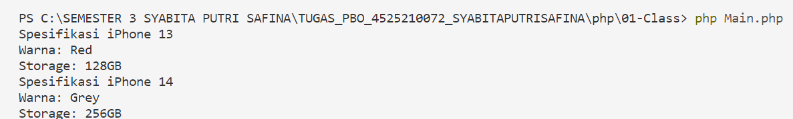
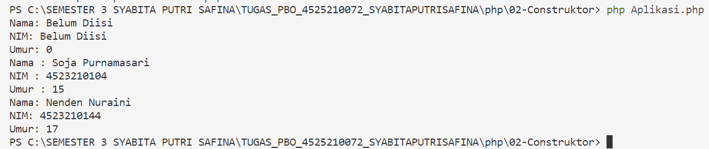
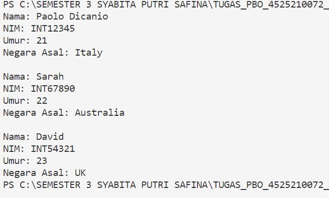
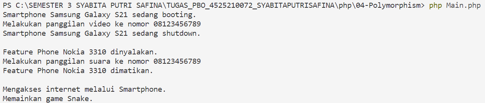
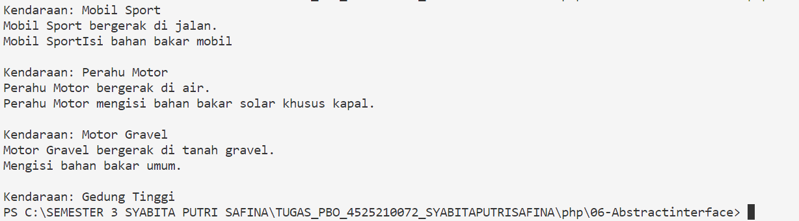

**NAMA : SYABITA PUTRI SAFINA**
**NPM : 4525210072**
# Tugas Pemrograman Berorientasi Objek

## Deskripsi
Repository ini dibuat untuk memenuhi tugas mata kuliah Pemrograman Berorientasi Objek (PBO)

## Pertemuan 01 - Class
Pada pertemuan 01 mempelajari konsep dasar **Class dan Object** dalam pemrograman berorientasi objek.

Class merupakan cetak biru yang digunakan untuk membuat sebuah object. Di dalam class terdapat property dan method yang digunakan untuk menyimpan data serta menjalankan suatu fungsi.

Pada tugas ini, source code Java mengenai class dikonversikan ke dalam bahasa PHP. Pada program digunakan sebuah class `iPhone` yang memiliki property seperti warna dan storage serta method untuk mengambil nilai dari property tersebut. 
### Screenshot 01

## Pertemuan 02 - Constructor

Pada pertemuan 02 mempelajari konsep **Constructor**.
Constructor merupakan method khusus yang secara otomatis dijalankan ketika sebuah object dibuat. Constructor digunakan untuk memberikan nilai awal kepada property yang dimiliki oleh sebuah object.
Pada proses konversi Java ke PHP, constructor disesuaikan menggunakan method `__construct()`
### Screenshot 02

## Pertemuan 03 - Inheritance

Pada pertemuan 03 mempelajari konsep **Inheritance atau pewarisan**
Pada tugas ini, source code Java mengenai inheritance dikonversikan ke dalam bahasa PHP dengan menggunakan konsep pewarisan antar-class.
### Screenshot 03

## Pertemuan 04 - Polymorphism

Pada pertemuan 04 mempelajari konsep **Polymorphism**.
Polymorphism merupakan konsep yang memungkinkan suatu method memiliki perilaku yang berbeda tergantung pada object atau class yang menggunakannya.
Pada tugas ini, source code Java mengenai polymorphism dikonversikan ke PHP dengan menyesuaikan sintaks dan aturan yang digunakan dalam bahasa PHP.
### Screenshot 04

## Pertemuan 05 - Association dan Composition

Pada pertemuan 05 mempelajari hubungan antar-object menggunakan konsep **Association dan Composition**.
Association merupakan hubungan antara satu object dengan object lainnya. Sedangkan composition merupakan hubungan yang lebih kuat, di mana suatu object menjadi bagian dari object lainnya.
Pada tugas ini, konsep Association dan Composition yang sebelumnya dibuat menggunakan Java dikonversikan ke dalam bahasa PHP.
### Screenshot 01

## Pertemuan 06 - Abstract Class dan Interface

Pada pertemuan 06 mempelajari konsep **Abstract Class dan Interface**.
Abstract class merupakan class yang digunakan sebagai dasar untuk class lainnya dan dapat memiliki method abstract yang harus diimplementasikan oleh child class.
Interface digunakan untuk menentukan method yang harus dimiliki oleh class yang mengimplementasikannya.
Pada tugas ini, konsep abstract class dan interface dari source code Java dikonversikan ke dalam bahasa PHP dengan menyesuaikan sintaks PHP.
### Screenshot 01

